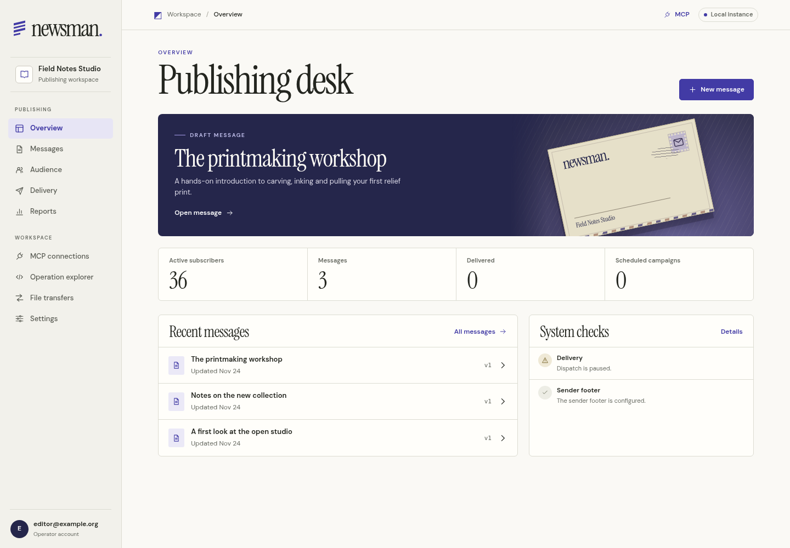
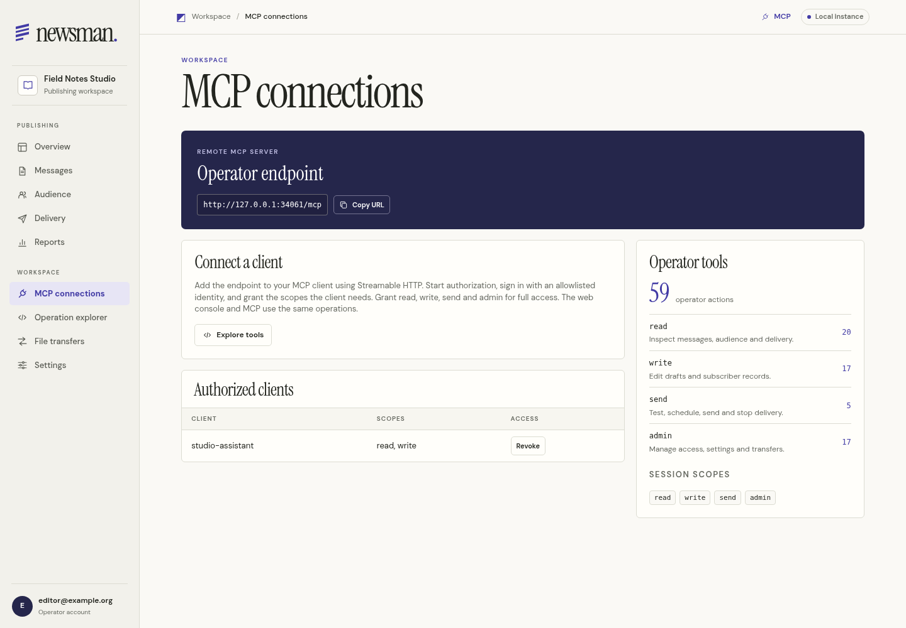

# newsman

Self-host an opt-in email workspace on Cloudflare Workers. Write a product update, invite contacts to an event, or publish a newsletter. Send one message now or choose its own delivery time. Amazon SES handles outbound email. An existing site or public archive is optional.

**The full web console is also an HTTP MCP server.** A remote client with the appropriate grant can draft and preview messages, upload files, manage an audience, schedule sends, export results, or administer the installation. The Rust Worker dispatches both interfaces through the same 59 operator operations. Five public, proof-scoped reader operations handle subscriptions. [Spekkr build specification](https://spekkr.com/dwrtz/newsman/) · [Operation registry](spec/operations.json)



## Run it locally

Use stable Rust, Node.js 24.22 or newer and npm. The local Worker uses an isolated D1 database, an R2 store, a loopback operator identity and a mailbox capture sink.

```sh
rustup target add wasm32-unknown-unknown
cargo install worker-build --version 0.9.0 --locked
npm ci
npm run build
npm run dev
```

Open **http://127.0.0.1:8787/**. To populate the local workspace with example messages and explicitly synthetic subscribers, run `npm run demo` in another terminal. Local state lives under `.newsman/local`. A new self-hosted installation starts with an empty audience and live dispatch paused.

## Connect an MCP client

Use Streamable HTTP at **`https://YOUR-HOST/mcp`**. Register your client's ID and exact redirect URI, then authorize it with the allowlisted operator identity. Request the application scopes the client needs. A full operator grant combines `read`, `write`, `send` and `admin`. Request `offline_access` for a refresh grant. Credentials stay with the client. The **MCP connections** screen displays the endpoint and lets an operator revoke grants. [Access and client setup](docs/access.md) · [MCP parity contract](spec/parity.md)

For example, a remote assistant can create a draft with `issue_create`, inspect both message bodies with `issue_render`, send a proof with `send_test`, and review a recipient set with `send_prepare`. Submitting the returned plan ID and digest to `send_commit` schedules or dispatches exactly that plan. The wire names retain `issue_*` for compatibility. A client can download private files using `file_read` and verify their SHA-256 digests. Reader interactions have a separate endpoint at `/reader/mcp`.



## Host your own instance

The Rust application compiles to WebAssembly. Cloudflare serves its HTML, CSS and JavaScript console, stores application records in D1 and private files in R2, and runs background delivery and import work. Each deployment has its own verified identities, audience and sender configuration. [Deployment and SES setup](docs/self-host.md) · [Import and migration](spec/migration.md)

## Verify the build

```sh
npm run build
npm test
npm run test:e2e
npm run check:deploy
```

Browser checks and screenshot generation use Chromium. Set `CHROMIUM_BIN` to its executable or install the Playwright-matched browser with `npx playwright-core install chromium`. The tests run Rust code in workerd with local D1/R2, exercise a standard MCP client, compare the complete web/MCP inventories, and cover proof, opt-out, import, export and individual dispatch behavior. `npm run screenshots` regenerates the three images in the spec using an isolated synthetic workspace.

The source and specification are MIT licensed. The bundled Instrument Serif and DM Sans fonts carry their own SIL Open Font Licenses under `public/fonts`. [MIT license](LICENSE)
